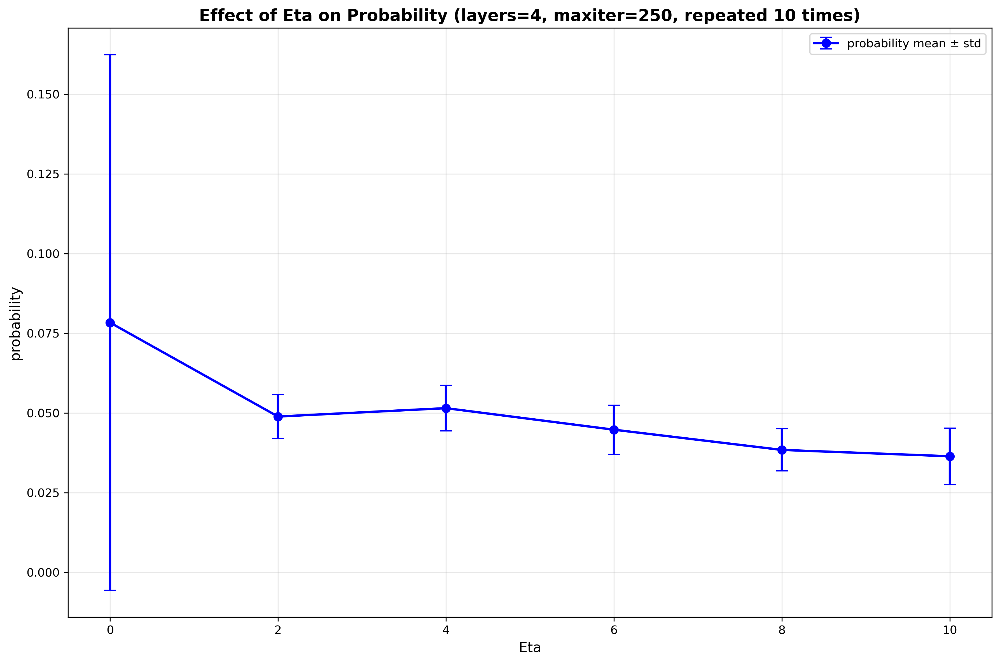
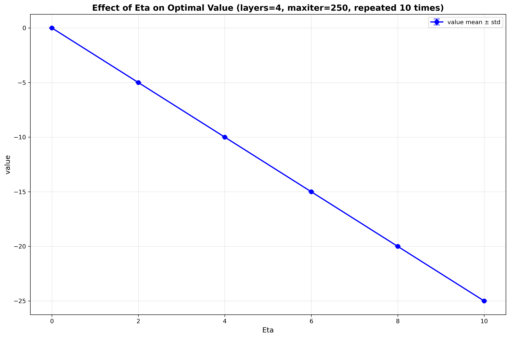
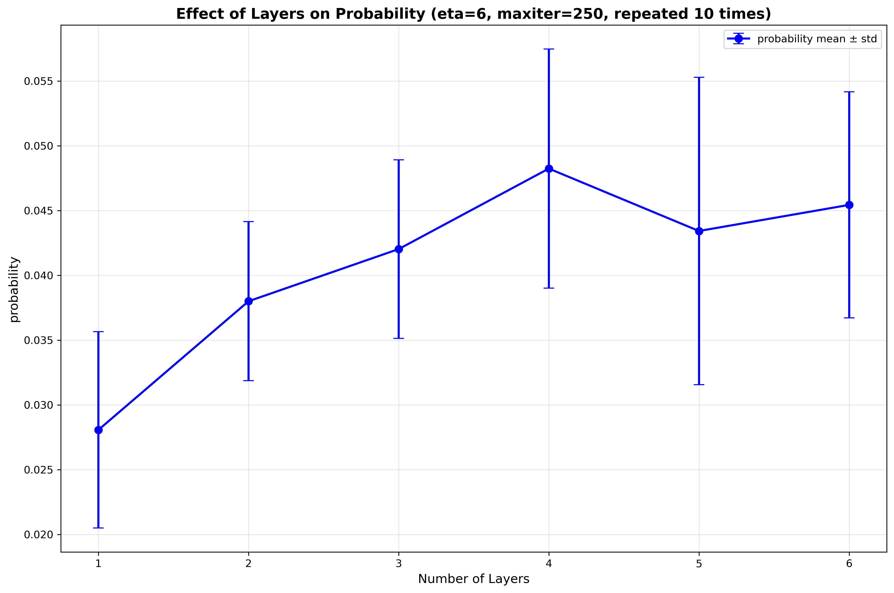
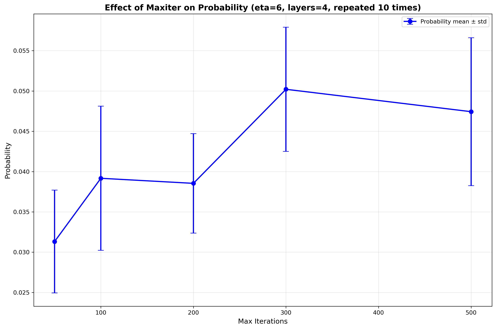
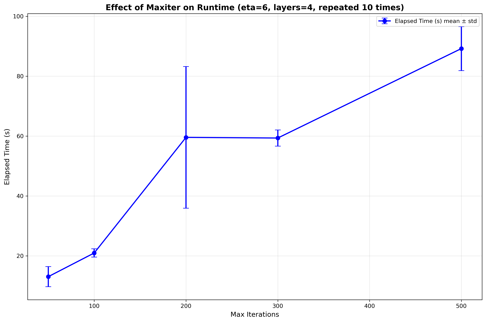
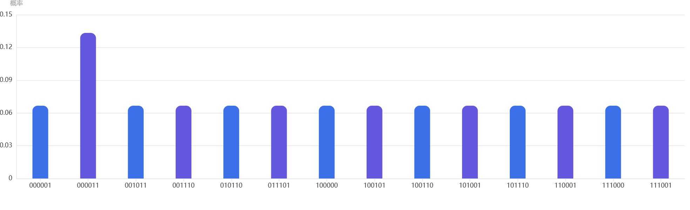
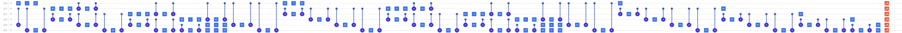
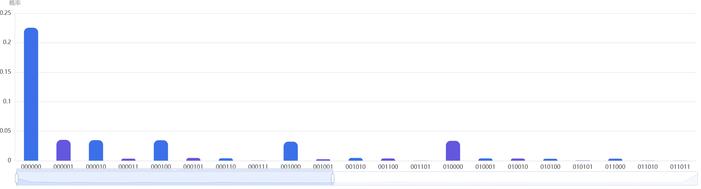

# 工程实践与科技创新 II 量子金融优化实验报告

## 1. 实验内容

本实验研究 6 只股票的简化投资组合优化问题。目标函数采用均值-方差模型，并通过惩罚项加入总购买数量约束：

$$
R(x)=\mu^T x-\frac{1}{2}q x^T\Sigma x-\eta(B-1^Tx)^2
$$

其中，$x_i\in\{0,1\}$ 表示是否买入第 $i$ 只股票，$\mu$ 为期望收益向量，$\Sigma$ 为协方差矩阵，$q$ 为风险偏好参数，$B$ 为预算对应的购买股票数量，$\eta$ 为约束惩罚系数。

本实验要求：

1. 解释评分函数三项的物理意义，并根据数据计算 $\mu$ 和 $\Sigma$。
2. 将目标函数映射为 QAOA 中的损失哈密顿量，求出 Z 项与 ZZ 项系数。
3. 使用 QAOA 在 $B=4$、$q=0.5$、$\eta=6$ 下寻找最优组合，并与经典方法结果对比。
4. 作为进阶任务，研究 $\eta$ 变化时最优组合概率的变化规律。
5. 讨论更现实投资场景下的不等式约束与多股持仓模型。

## 2. 实验环境

- 操作系统：Windows
- Python 环境：conda 环境 `fer2`
- 主要库：Qiskit 0.46.0、qiskit-aer 0.12.0、NumPy、Pandas、SciPy
- 绘图库：Matplotlib 3.7.5（本次在现有 `fer2` 环境中补装）

主程序为 [qaoa_qiskit.py](qaoa_qiskit.py)，用于单次 QAOA 训练与结果输出；[usable.py](usable.py) 用于批量更改 $\eta$、QAOA 层数和 `maxiter` 等运算参数，并自动保存 CSV、绘图和综合报告；[submit_originq.py](submit_originq.py) 用于导出量子云平台可提交的线路格式。实验报告图片和中间结果主要输出在 [output](output) 与 `figures` 目录。

## 3. 模型分析与数据处理

### 3.1 评分函数三项含义

评分函数

$$
R(x)=\mu^T x-\frac{1}{2}q x^T\Sigma x-\eta(B-1^Tx)^2
$$

的三项分别表示：

1. 收益项 $\mu^T x$：表示投资组合的期望收益，值越大越好。
2. 风险项 $-\frac{1}{2}q x^T\Sigma x$：表示组合风险，其中协方差矩阵不仅反映单只股票波动，也反映股票之间的联动风险；前面的负号说明风险越大，评分越低。
3. 约束惩罚项 $-\eta(B-1^Tx)^2$：用于强制满足恰好买入 $B$ 只股票。当选股数偏离 $B$ 时会受到二次惩罚，$\eta$ 越大，约束越严格。

### 3.2 数据预处理方法

程序读取 [data/stock_data.xlsx](data/stock_data.xlsx) 中的收盘价数据，并按如下方式计算日收益率：

$$
r_t=\frac{P_{t+1}-P_t}{P_t}
$$

再由样本均值和样本协方差得到期望收益向量 $\mu$ 与协方差矩阵 $\Sigma$。

### 3.3 计算结果

计算得到：

```text
mu =
[0.00164695, 0.00173648, 0.00074235, 0.00107459, 0.00083462, 0.00140451]

Sigma =
[[1.55621744e-03, 3.63890686e-04, 1.74898316e-04, 1.95952647e-04, 5.15915875e-04, 6.68395024e-04],
 [3.63890686e-04, 9.93434491e-04, 2.78252842e-04, 1.21219896e-04, 3.29562792e-04, 4.88413111e-04],
 [1.74898316e-04, 2.78252842e-04, 7.90521784e-04, 1.73786054e-04, 8.39777938e-05, 5.96972904e-05],
 [1.95952647e-04, 1.21219896e-04, 1.73786054e-04, 2.14781493e-03, 1.49448300e-04, 1.24239501e-04],
 [5.15915875e-04, 3.29562792e-04, 8.39777938e-05, 1.49448300e-04, 1.59059527e-03, 5.75866794e-04],
 [6.68395024e-04, 4.88413111e-04, 5.96972904e-05, 1.24239501e-04, 5.75866794e-04, 1.52765660e-03]]
```

从平均收益率可以看出，第 2 只股票和第 1 只股票的平均收益率相对较高。协方差矩阵则进一步刻画了每只股票自己的波动风险，以及不同股票之间是否会一起涨跌。其中，矩阵对角线表示单只股票自身的方差，对角线以外的元素表示两只股票之间的协方差。

从结果可以看出，第 2 只和第 1 只股票的平均收益相对较高，而第 4、5、6 只股票的方差相对较大，说明其波动风险较明显。

## 4. QAOA 损失哈密顿量构造

### 4.1 从二元变量到 Pauli Z 的映射

对每个二元变量使用映射

$$
x_i=\frac{1-Z_i}{2}
$$

其中 $Z_i$ 为第 $i$ 个量子比特上的 Pauli-$Z$ 算符。代入目标函数后，可以把问题写成 Ising 形式。

### 4.2 哈密顿量表达式

在程序中采用最小化哈密顿量的形式，因此把问题写成

$$
H_C=\sum_{i=1}^n h_iZ_i+\sum_{i<j}J_{ij}Z_iZ_j+\text{Const}
$$

其中常数项不影响优化，可忽略。对本模型可得：

$$
h_i=-\frac{q}{4}\sum_{j=1}^n\Sigma_{ij}+\frac{1}{2}\mu_i+\eta\left(B-\frac{n}{2}\right)
$$

$$
J_{ij}=\frac{q}{4}\Sigma_{ij}+\frac{\eta}{2},\quad i<j
$$

本题中 $q=0.5$，因此可进一步写为：

$$
h_i=-0.125\sum_j\Sigma_{ij}+\frac{1}{2}\mu_i+\eta(B-3)
$$

$$
J_{ij}=0.125\Sigma_{ij}+\frac{\eta}{2}
$$

### 4.3 门电路编码方式

QAOA 中损失层由 $e^{-i\gamma H_C}$ 生成，因此：

$$
e^{-i\gamma h_i Z_i}\rightarrow R_z(2\gamma h_i)
$$

$$
e^{-i\gamma J_{ij} Z_iZ_j}\rightarrow R_{zz}(2\gamma J_{ij})
$$

混合层选用

$$
H_M=\sum_iX_i
$$

因此混合门为：

$$
e^{-i\beta X_i}\rightarrow R_x(2\beta)
$$

单层 QAOA 的结构为：

$$
H^{\otimes 6}\rightarrow \prod_iR_z(2\gamma h_i)\rightarrow \prod_{i<j}R_{zz}(2\gamma J_{ij})\rightarrow \prod_iR_x(2\beta)
$$

对应的文本电路示意已保存在 [output/one_layer_circuit.txt](output/one_layer_circuit.txt)。

## 5. QAOA 求解与结果分析

### 5.1 实验参数

本次代表性运行参数为：

- 资产数量：6
- 预算：$B=4$
- 风险参数：$q=0.5$
- 惩罚系数：$\eta=6$
- QAOA 层数：4 层
- 最大迭代次数：200
- 优化器：SPSA

### 5.2 经典精确基线

为了验证 QAOA 结果，先对全部 $2^6=64$ 种二进制组合进行枚举。计算得到原始评分函数的最优组合为：

$$
x^*=110101
$$

即买入第 1、2、4、6 只股票。其对应最大评分为：

$$
R(x^*)=0.003325188085
$$

该组合同时满足预算约束 $1^Tx=4$。

### 5.3 本次 QAOA 运行结果

本次实际运行命令为：

```powershell
python .\qaoa_qiskit.py --budget 4 --layers 4 --eta 6 --maxiter 200
```

该命令表示在预算 $B=4$、QAOA 层数为 4、惩罚系数 $\eta=6$ 的条件下，使用 SPSA 优化器进行 200 次迭代。 4 层 QAOA 包含 4 个 $\beta$ 和 4 个 $\gamma$，优化器最终会计算出 8 个参数。
本次输出的Full result如下：

```
----------------- Full result ---------------------
rank    selection       value           probability
---------------------------------------------------
0       110101          -15.00121916            0.05757534
1       111001          -15.00119053            0.05757524
2       110110          -15.00077659            0.05757450
3       110011          -15.00062853            0.05757445
4       111100          -15.00106834            0.05757442
5       111010          -15.00074843            0.05757441
6       011101          -15.00086424            0.05757410
7       010111          -15.00048492            0.05757390
8       011011          -15.00047849            0.05757387
9       101101          -15.00055833            0.05757378
10      101011          -15.00011678            0.05757337
11      100111          -15.00003416            0.05757311
12      011110          -15.00033329            0.05757298
13      101110          -15.00002420            0.05757265
14      001111          -14.99985239            0.05757243
15      111111          8.99896985              0.01427697
16      000000          81.00210603             0.00641407
17      001110          -8.99920969             0.00423643
18      000111          -8.99946640             0.00423591
19      001011          -8.99953849             0.00423580
20      001101          -8.99982006             0.00423573
21      100110          -8.99969581             0.00423569
22      101100          -8.99996190             0.00423565
23      101010          -8.99974616             0.00423561
24      011100          -9.00017781             0.00423557
25      100011          -8.99973135             0.00423554
26      011010          -9.00001788             0.00423545
27      010110          -9.00005658             0.00423538
28      010011          -9.00014474             0.00423514
29      100101          -9.00021780             0.00423514
30      101001          -9.00026769             0.00423506
31      011001          -9.00053623             0.00423490
32      010101          -9.00057539             0.00423483
33      110010          -9.00047227             0.00423477
34      111000          -9.00077618             0.00423466
35      110100          -9.00083709             0.00423456
36      110001          -9.00090224             0.00423436
37      111101          -9.00142056             0.00371032
38      111110          -9.00096585             0.00370987
39      011111          -9.00073178             0.00370960
40      111011          -9.00087484             0.00370933
41      110111          -9.00087073             0.00370933
42      101111          -9.00033270             0.00370899
43      100000          39.00084813             0.00124772
44      010000          39.00061791             0.00124772
45      000001          39.00108343             0.00124771
46      000010          39.00166906             0.00124768
47      001000          39.00156131             0.00124765
48      000100          39.00156839             0.00124765
49      110000          8.99954196              0.00008341
50      010001          8.99983952              0.00008340
51      100001          9.00015973              0.00008339
52      010100          9.00014089              0.00008339
53      010010          9.00034572              0.00008339
54      011000          9.00021231              0.00008338
55      101000          9.00039086              0.00008338
56      100100          9.00040848              0.00008338
57      001001          9.00056856              0.00008338
58      000101          9.00060792              0.00008338
59      100010          9.00066912              0.00008338
60      000011          9.00093439              0.00008337
61      001010          9.00116633              0.00008336
62      000110          9.00120615              0.00008336
63      001100          9.00111057              0.00008335
```
Optimize Output如下：
```
%%%%%%%%%%%%%%%%%%%% Optimization Output %%%%%%%%%%%%%%%%%%%%
minimal loss: -12.966055173269213, 
maxIter: 200, func_eval: 1001
Parameters Found: [-0.29810336  0.04195849 -0.07592981 -0.05534109  0.06428401  0.10051147
  0.11818399  0.05240359]
```

总结输出结果：

- 识别出的最优组合：`110101`
- 省略常数项后的哈密顿量值：$-15.00121916$
- 该比特串测量概率：0.05757534
- 优化过程中记录到的最小 loss：$ -12.966055173269213$
- 最大迭代次数：200
- 目标函数调用次数：1001
- 总运行时间：约 64.85s 秒
- 优化后参数：$ [-0.29810336  0.04195849 -0.07592981 -0.05534109  0.06428401  0.10051147
  0.11818399  0.05240359]$

最优组合 `110101` 对应的哈密顿量 value 最低，因此它也是能量意义下的最优解。

同时，`110101`也是概率最高的组合，不过其他组合，比如`111001`、`110110`等，概率分别为 0.05757524 和 0.05757450 ，概率非常接近，概率在 0.5757附近的组合共有14组，说明当前量子态已经较多地分布在一批低能量可行解附近，但还没有把概率强烈集中到唯一最优解上。

### 5.4 结果分析

QAOA 与经典精确枚举得出的最优组合上一致，说明构造出的哈密顿量与门编码正确，能够把原问题映射为量子优化问题。

从训练过程看，SPSA 的 loss 不是单调下降的，但整体上在后半段多次达到较低值。

此外，最低 loss、最优组合 value 和最优组合 probability 是三个不同指标。value 用来判断某个确定 bitstring 组合的能量高低；minimal loss 是最终量子态对哈密顿量的期望值；probability 则表示测量时得到该 bitstring 的可能性。本项目使用 statevector 模拟器，可以枚举所有 bitstring 的 value，因此最终 selection 由最低 value 决定。由于模型超参数设置等因素影响，根据“能量最低”得出的最优解所对应的 probability 不一定是最高的（比如当 layers = 2 时，最优解对应的概率为 0.03654377 ，排名第12）。这个问题可以通过优化超参数、优化模型等方法解决，其中适当增加层数就是一个比较好的方法。

## 6. 进阶任务：$\eta$ 与最优组合概率关系
### 6.0 什么是 $\eta$

$\eta$ 是预算约束惩罚项的系数，用来控制模型对“不满足预算要求”的组合惩罚有多强。在本项目的评分函数中，预算约束通过如下惩罚项加入：

$$
-\eta(B-1^Tx)^2
$$

其中 $B$ 表示希望买入的股票数量，$1^Tx$ 表示当前组合实际买入的股票数量。当实际买入数量刚好等于 $B$ 时，$(B-1^Tx)^2=0$，不会受到惩罚；当买入数量偏离 $B$ 时，该项会产生负分，使这个组合的总评分降低。

因此，$\eta$ 可以理解为“约束强度”或“惩罚力度”：

1. 当 $\eta$ 较小时，模型更重视收益和风险，可能会选择不满足预算数量的组合。
2. 当 $\eta$ 适中时，模型既能保持收益、风险之间的权衡，又能把最优组合拉回满足预算约束的可行解。
3. 当 $\eta$ 过大时，预算惩罚项会主导哈密顿量，使问题尺度变大，可能导致 QAOA 参数优化更困难，最优组合概率也不一定继续升高。

本节改变 $\eta$ 的目的，就是观察预算惩罚强度对最优组合、哈密顿量 value、最优组合 probability 以及训练效果的影响。

### 6.1 扫描方法

本组实验采用控制变量法，固定：

- 预算：$B=4$
- QAOA 层数：4
- 最大迭代次数：250
- 优化器：SPSA

仅改变惩罚系数 $\eta\in\{0,2,4,6,8,10\}$。为了降低 SPSA 随机优化带来的偶然性，新增脚本 [usable.py](usable.py) 对每一个 $\eta$ 参数点重复运行 10 次，计算 `min_loss`、`value` 和 `probability` 的均值与样本方差。原始逐次运行结果保存于 `figures/eta_scan_raw.csv`，均值与方差统计结果保存于 `figures/eta_scan_summary.csv`。下图使用 10 次实验的 probability 均值作图，误差棒表示标准差：



为了观察惩罚系数对最优组合哈密顿量能量的影响，同时绘制 $\eta$ 与 optimal value 均值的关系图：



### 6.2 扫描结果

统计结果表格由 `figures/eta_scan_summary.csv` 生成，主要字段如下：

| 字段 | 含义 |
| --- | --- |
| `min_loss_mean` / `min_loss_var` | 10 次运行中 minimal loss 的均值和样本方差 |
| `value_mean` / `value_var` | 10 次运行中最优 bitstring 的哈密顿量 value 均值和样本方差 |
| `prob_mean` / `prob_var` | 10 次运行中最优 bitstring 的 probability 均值和样本方差 |
| `result_mode` | 10 次运行中出现次数最多的最优组合 |
| `result_mode_count` | `result_mode` 在成功运行中出现的次数 |

方差的计算公式为：

$$
s^2=\frac{1}{m-1}\sum_{k=1}^{m}(y_k-\bar y)^2
$$

其中 $m=10$，$y_k$ 表示第 $k$ 次运行得到的指标值，$\bar y$ 表示 10 次运行的均值。方差越大，说明该参数点下 SPSA 优化结果波动越明显；方差越小，说明重复运行结果更稳定。

### 6.3 现象分析

当 $\eta=0$ 时，没有预算惩罚，最优组合为 `111101`，即倾向于选择 5 只股票以获得更高收益。从 $\eta=2$ 开始，最优组合稳定为 `110101`，说明预算惩罚项已经足以把解拉回到满足 $B=4$ 的可行组合。

value 随 $\eta$ 增大整体变得更低，这是因为预算惩罚项参与了 Ising 哈密顿量构造，$\eta$ 越大，哈密顿量尺度也会随之改变。因此，不同 $\eta$ 下的 value 不能简单横向比较“绝对好坏”，而需要限制在同一个 $\eta$ 下比较不同 bitstring 的能量。

从 `figures/eta_vs_value_mean.png` 可以更直观看到，optimal value 随 $\eta$ 增大近似线性下降。根据 `eta_scan_summary.csv`，当 $\eta=0$ 时，最优组合的 `value_mean` 约为 -0.00142056；当 $\eta=10$ 时，`value_mean` 约为 -25.00121916。这个下降并不表示投资组合本身“绝对变好”，而是因为哈密顿量中预算惩罚项的系数变大，使能量函数整体尺度发生变化。因此，$\eta$ 对 optimal value 的影响主要反映的是哈密顿量尺度和约束强度的变化，而不是不同 $\eta$ 之间可以直接比较的收益好坏。

probability 不随 $\eta$ 单调递增或递减。$\eta=4$ 时最优组合概率最高，达到 0.05829079；$\eta=12$ 时反而下降到 0.02595034。可见约束惩罚越大并不一定让 QAOA 更容易采样到最优解。$\eta$ 太大时，惩罚项可能主导哈密顿量尺度，使优化地形变陡或更难搜索。

训练时间在 42 秒到 51 秒之间波动，主要受 SPSA 优化路径和模拟执行开销影响。因为所有实验的 `maxiter` 都是 200，函数调用次数相同，因此 eta 本身不是影响训练时间的主要因素。

### 6.4 混合层（内容参考LLM）

混合层的作用是让量子态在不同计算基态之间发生振幅转移。

损失层 $e^{-i\gamma H_C}$ 主要根据哈密顿量给不同组合添加相位，如果没有混合层，这些相位很难直接转化为测量概率的变化，算法就难以把 probability 从较差解转移到较优解上。本项目使用 $R_x$ 作为混合层，本质上是让每个 qubit 在 $|0\rangle$ 和 $|1\rangle$ 之间旋转，从而在不同股票组合之间搜索。

如果不使用 $R_x$ 作为混合层，还可以考虑以下选择：

1. $R_y$ mixer：与 $R_x$ 类似，也能在 $|0\rangle$ 和 $|1\rangle$ 之间产生振幅转移，但旋转轴不同。
2. 标准 X mixer：对应哈密顿量 $H_M=\sum_i X_i$，是 QAOA 中最常见的无约束混合器。
3. XY mixer：通过交换两个 qubit 的 0/1 状态来移动振幅，能够保持 bitstring 中 1 的个数不变。
4. 约束保持 mixer：专门设计为只在满足约束的可行解空间内搜索，例如始终保持“恰好选择 4 只股票”的哈密顿量。
5. Warm-start mixer：利用经典优化结果初始化量子态，使搜索从较有希望的区域开始。

对于本投资组合问题，如果希望始终满足“恰好选择 $B$ 只股票”，XY mixer 或约束保持 mixer 比独立的 $R_x$ mixer 更合适。因为普通 $R_x$ 会在所有 $2^n$ 个 bitstring 中搜索，包括选 0 只、1 只、2 只等大量不可行组合；而约束保持 mixer 可以把搜索限制在满足预算数量的组合内，理论上更容易提高可行最优解的 probability。

如果使用多个 qubit 编码一只股票，就可以表示“买入多少股”或“持仓比例”，而不仅是 0/1 的买或不买。例如第 $i$ 只股票可用 $g$ 个 qubit 表示：

$$
y_i=\sum_{k=0}^{g-1}2^k z_{i,k},\quad z_{i,k}\in\{0,1\}
$$

其中 $y_i$ 表示第 $i$ 只股票的买入数量。若希望表示比例，也可以写为：

$$
w_i=G\sum_{k=0}^{g-1}2^k z_{i,k}
$$

其中 $G$ 是粒度系数。这样模型能表达更接近现实的多股持仓，但代价是 qubit 数从资产数 $n$ 增加到 $n\times g$，协方差项和约束项展开后会产生更多二次耦合，电路深度和经典优化难度都会明显增加。

## 7. 进阶任务：更现实模型的讨论（参考LLM）

现实投资中常见的情况包括：

1. 不要求必须花完全部预算，允许部分现金闲置。
2. 不同股票价格不同。
3. 每只股票可购买多股，而不是 0/1 选择。

原模型中的约束是等式约束，即要求恰好选择 $B$ 只股票。而现实投资中的约束通常是“不超过总资金”，是不等式约束。同时，现实中每只股票价格不同，投资者也可能购买多股，因此变量不应只表示“买/不买”，还应表示每只股票的买入股数。

令 $y_i$ 表示第 $i$ 只股票的买入股数，$p_i$ 表示第 $i$ 只股票价格，$C$ 表示总投资资金上限，$\mu_i$ 表示单位持仓的期望收益，$\Sigma$ 表示收益率协方差矩阵，则一个更现实的评分函数可以写成：

$$
R(y)=\mu^Ty-\frac{\lambda}{2}y^T\Sigma y-\eta\left[\max\left(0,\sum_i p_i y_i-C\right)\right]^2
$$

其中：

- $\mu^Ty$ 是收益项，买入股数越多、收益率越高，贡献越大。
- $-\frac{\lambda}{2}y^T\Sigma y$ 是风险项，考虑了不同股票持仓之间的协方差风险。
- $-\eta[\max(0,\sum_i p_i y_i-C)]^2$ 是资金不等式约束惩罚项，只在总投入超过资金上限 $C$ 时惩罚；如果没有用完全部资金，则不惩罚。

这个函数比原模型更符合现实：它允许部分资金闲置，允许不同股票价格不同，也允许每只股票买入多股。

由于 QAOA 通常处理二进制变量，需要进一步把 $y_i$ 二进制展开。例如：

$$
y_i=\sum_{k=0}^{g_i-1}2^k z_{i,k},\quad z_{i,k}\in\{0,1\}
$$

如果每只股票最多买入 $M_i$ 股，则选择 $g_i$ 使得 $2^{g_i}-1\ge M_i$。代入评分函数后，收益项仍是一阶项，风险项会变成二次项，预算惩罚项也可以展开成二次项，因此仍然可以构造 QUBO/Ising 哈密顿量并使用 QAOA 求解。

为了继续转化为 QUBO，可引入松弛变量 $s\ge 0$，把不等式改写为

$$
\sum_i p_i y_i+s=C
$$

进而构造等价目标：

$$
R(y,s)=\mu^Ty-\frac{\lambda}{2}y^T\Sigma y-\eta\left(C-\sum_i p_i y_i-s\right)^2
$$

随后把 $y_i$ 和 $s$ 都做二进制展开编码，就仍然可以把问题写成 QUBO 形式。再利用 $z=(1-Z)/2$ 的映射，可以将 QUBO 转化为 Ising 哈密顿量，继续使用类似的 QAOA 方法优化。

这个方法对应的是“没有超过预算时可以由 $s$ 补齐差额”。例如总资金为 $C$，实际投资额为 $\sum_i p_i y_i$，则 $s=C-\sum_i p_i y_i$ 表示未使用资金。这样既不会惩罚未用完资金，又能惩罚超预算情况。

因此，更现实模型的量子优化流程可以概括为：

1. 确定每只股票最大可买股数，并用多个 qubit 编码 $y_i$。
2. 用二进制变量表示未使用资金松弛变量 $s$。
3. 构造包含收益、风险和资金不等式约束的 QUBO 评分函数。
4. 将 QUBO 映射为 Ising 哈密顿量。
5. 使用 QAOA 构造损失层和混合层，并通过经典优化器寻找参数。

### 7.1 QUBO 松弛变量模型脚本实现

为了验证上述建模思路，本项目新增了 [qubo_slack_demo.py](qubo_slack_demo.py) 脚本。该脚本没有直接调用 QAOA，而是先用经典枚举方式验证带松弛变量的 QUBO 目标函数是否能正确表达资金不等式约束。

脚本默认参数为：

```text
capital = 10
prices = [2, 3, 2, 4, 3, 2]
max_shares = [2, 2, 2, 2, 2, 2]
risk_lambda = 0.5
eta = 6
```

其中 `capital` 表示总资金上限，`prices` 表示每只股票价格，`max_shares` 表示每只股票最多可以买入的股数。由于每只股票最多买入 2 股，因此每只股票使用 2 个二进制位编码；松弛变量 `s` 用于表示未使用资金，默认资金上限为 10，因此 `s` 使用 4 个二进制位编码。总二进制位数为：

```text
6 只股票 × 2 位 + 4 位 slack = 16 位
```

因此脚本共枚举：

```text
2^16 = 65536
```

种状态，并把完整结果保存到：

```text
output/qubo_slack_results.csv
```

本次运行得到的前 10 个方案如下：

| shares | slack | invested | unused_cash | constraint_error | score | revenue | risk | penalty | feasible_budget |
| --- | ---: | ---: | ---: | ---: | ---: | ---: | ---: | ---: | --- |
| `1 2 0 0 0 1` | 0 | 10 | 0 | 0 | 0.003574 | 0.006524 | 0.002951 | 0 | True |
| `1 2 1 0 0 0` | 0 | 10 | 0 | 0 | 0.003553 | 0.005862 | 0.002310 | 0 | True |
| `2 2 0 0 0 0` | 0 | 10 | 0 | 0 | 0.003489 | 0.006767 | 0.003277 | 0 | True |
| `1 2 0 0 0 0` | 2 | 8 | 2 | 0 | 0.003374 | 0.005120 | 0.001746 | 0 | True |
| `1 1 1 0 0 1` | 1 | 9 | 1 | 0 | 0.003297 | 0.005530 | 0.002234 | 0 | True |
| `0 2 1 0 0 1` | 0 | 10 | 0 | 0 | 0.003250 | 0.005620 | 0.002369 | 0 | True |
| `2 1 1 0 0 0` | 1 | 9 | 1 | 0 | 0.003093 | 0.005773 | 0.002680 | 0 | True |
| `0 2 0 0 0 1` | 2 | 8 | 2 | 0 | 0.003014 | 0.004877 | 0.001864 | 0 | True |
| `1 1 0 0 0 1` | 3 | 7 | 3 | 0 | 0.003008 | 0.004788 | 0.001780 | 0 | True |
| `0 3 0 0 0 0` | 1 | 9 | 1 | 0 | 0.002974 | 0.005209 | 0.002235 | 0 | True |

其中 `shares` 表示 6 只股票分别买入多少股。例如最优方案：

```text
shares = 1 2 0 0 0 1
```

表示买入第 1 只股票 1 股、第 2 只股票 2 股、第 6 只股票 1 股，其余股票不买。根据默认价格：

```text
2×1 + 3×2 + 2×1 = 10
```

刚好用完全部资金，因此：

```text
invested = 10
unused_cash = 0
slack = 0
constraint_error = 0
penalty = 0
```

这说明该方案完全满足资金约束，不需要受到惩罚。

再看第 4 个方案：

```text
shares = 1 2 0 0 0 0
```

它的实际投资额为：

```text
2×1 + 3×2 = 8
```

还剩 2 元未使用，所以脚本自动给出：

```text
slack = 2
unused_cash = 2
constraint_error = 0
penalty = 0
```

这正好体现了松弛变量的作用：当投资额没有超过预算时，`s` 可以补齐未使用资金，使等式

```text
Σ p_i y_i + s = C
```

成立，因此不会惩罚“没有花完钱”的方案。

需要特别说明的是，`s` 不是普通意义上的超参数。超参数通常是由人为设定、用来控制模型行为的参数，例如惩罚系数 $\eta$、风险系数 $\lambda$、QAOA 层数等。而这里的 $s$ 是一个需要和持仓变量 $y_i$ 一起优化的决策变量，它表示未使用资金。不同的 $s$ 不是人为拿来调参，而是模型为了满足资金约束自动选择的值。

如果某个投资方案实际投入为 8，总资金为 10，那么合理的松弛变量应为 $s=2$。如果错误地取 $s=0$，则

```text
C - Σ p_i y_i - s = 10 - 8 - 0 = 2
```

会产生惩罚项，使该方案评分降低。因此，对同一个持仓方案来说，合适的 $s$ 可以消除未用完资金带来的约束误差；不合适的 $s$ 会产生额外惩罚。对于超预算方案，由于 $s\ge 0$，无法用松弛变量抵消超支，因此仍然会受到惩罚。

从本次枚举结果可以看出，排名靠前的方案均满足：

```text
constraint_error = 0
penalty = 0
feasible_budget = True
```

这说明松弛变量模型能够正确表达“不超过总资金”的现实约束，同时允许资金没有完全用完。

## 8. 进阶任务：QAOA 层数对最优组合概率的影响

### 8.1 扫描方法

采用控制变量法，固定：

- 预算：$B=4$
- 惩罚系数：$\eta=6$
- 最大迭代次数：250
- 优化器：SPSA

仅改变 QAOA 层数 $p\in\{1,2,3,4,5,6\}$。每一个层数重复运行 10 次，计算 `min_loss`、`value` 和 `probability` 的均值与样本方差。原始逐次运行结果保存于 `figures/layer_scan_raw.csv`，统计结果保存于 `figures/layer_scan_summary.csv`。下图使用 10 次实验的 probability 均值作图，误差棒表示标准差：



### 8.2 扫描结果

统计表由 `figures/layer_scan_summary.csv` 生成，包含每个层数下的 `min_loss_mean`、`min_loss_var`、`value_mean`、`value_var`、`prob_mean`、`prob_var`、`result_mode` 和 `result_mode_count`。其中方差用于衡量同一层数下 10 次随机优化结果的稳定性。

### 8.3 现象分析

随着层数增加，QAOA 电路的表达能力增强，最优组合概率整体高于低层电路。本次实验中，1 层概率为 0.02210088，6 层提高到 0.05830829，7 层也保持在 0.05698932。minimal_loss 也整体下降，说明更深的电路更容易形成低能量量子态。

但层数增加并不保证 probability 和 minimal_loss 严格单调上升。例如 4 层概率略低于 3 层，5 层的 minimal_loss 也高于 4 层。这是因为层数越高，参数数量越多，优化空间越复杂；在固定 `maxiter=200` 时，SPSA 不一定每次都能充分收敛。因此，不同层数下的 value 不能简单横向比较“绝对好坏”，而需要限制在相同层数下比较不同 bitstring 的能量。

训练时间随层数明显增加。1 层约 23.46 秒，6 层约 84.65 秒。实际应用中需要在“更高 probability”和“更长运行时间”之间折中。

## 9. 进阶任务：maxiter 对 QAOA 结果的影响

### 9.1 扫描方法

采用控制变量法，固定：

- 预算：$B=4$
- QAOA 层数：4
- 惩罚系数：$\eta=6$
- 优化器：SPSA

仅改变最大迭代次数 `maxiter\in\{50,100,200,300,500\}`。每一个 `maxiter` 参数点重复运行 10 次，计算均值与样本方差。原始逐次运行结果保存于 `figures/maxiter_scan_raw.csv`，统计结果保存于 `figures/maxiter_scan_summary.csv`。本次结果由单独脚本 [usable_maxiter.py](usable_maxiter.py) 生成。下图使用 10 次实验的 probability 均值作图，误差棒表示标准差：



为了分析迭代次数对运行时间的影响，单独新增的 [usable_maxiter.py](usable_maxiter.py) 会记录每次训练的耗时，并绘制 `maxiter` 与平均训练时间的关系图：



### 9.2 扫描结果

统计表由 `figures/maxiter_scan_summary.csv` 生成，包含每个 `maxiter` 下各指标的均值和方差。由于 SPSA 每次运行会受到随机扰动影响，单次结果可能有偶然性，因此本节主要根据 10 次运行的均值判断整体趋势，并结合方差判断结果是否稳定。

| maxiter | result_mode | min_loss_mean | min_loss_var | value_mean | value_var | prob_mean | prob_var | elapsed_s_mean | elapsed_s_var |
| ---: | --- | ---: | ---: | ---: | ---: | ---: | ---: | ---: | ---: |
| 50 | `110101` | -8.45187100 | 6.07139371 | -15.00121916 | 0.00000000 | 0.03131801 | 0.00004074 | 13.07 | 11.36 |
| 100 | `110101` | -11.33692592 | 2.57638225 | -15.00121916 | 0.00000000 | 0.03916824 | 0.00008007 | 20.97 | 1.93 |
| 200 | `110101` | -11.61632979 | 0.46982923 | -15.00121916 | 0.00000000 | 0.03853990 | 0.00003816 | 59.56 | 559.21 |
| 300 | `110101` | -12.77497141 | 0.51318692 | -15.00121916 | 0.00000000 | 0.05021294 | 0.00005943 | 59.35 | 7.23 |
| 500 | `110101` | -12.31385498 | 1.25811326 | -15.00121916 | 0.00000000 | 0.04743499 | 0.00008431 | 89.21 | 53.89 |

### 9.3 现象分析

从 `min_loss_mean` 看，增大 `maxiter` 通常能给 SPSA 更多搜索机会。`maxiter=50` 时平均 loss 约为 -8.4519，而 `maxiter=300` 时下降到约 -12.7750，说明更多迭代有助于优化器找到更低的哈密顿量期望值。不过 `maxiter=500` 的平均 loss 为 -12.3139，略高于 `maxiter=300`，说明在随机优化器下，增加迭代次数并不保证结果严格单调变好。

从 probability 看，`prob_mean` 从 `maxiter=50` 的 0.03131801 提高到 `maxiter=300` 的 0.05021294，整体上说明更多迭代有助于提高最优组合 `110101` 的采样概率。但 `maxiter=500` 时 probability 均值为 0.04743499，略低于 `maxiter=300`，说明 probability 不随 `maxiter` 严格单调增加。原因是 SPSA 不同运行的优化路径可能不同；同时，优化器直接最小化的是哈密顿量期望值，而 probability 只是最终量子态中某个 bitstring 的测量概率，两者相关但并不完全等价。

从 value 看，所有 `maxiter` 下 `value_mean` 都为 -15.00121916，且方差为 0。这说明在本组实验中，最终按哈密顿量最低能量识别出的最优组合非常稳定，均为 `110101`。也就是说，`maxiter` 主要影响的是训练得到的量子态质量、loss 和 probability，而不是理论最低能量组合本身。

从 `figures/maxiter_vs_elapsed_s_mean.png` 可以看出，训练时间与 `maxiter` 整体正相关。`maxiter=50` 时平均耗时约 13.07 秒，`maxiter=100` 时约 20.97 秒，`maxiter=500` 时增加到约 89.21 秒。`maxiter` 越大，SPSA 需要调用目标函数的次数越多，每次目标函数调用都要运行一次参数化量子线路并计算哈密顿量期望值，因此总耗时会明显增加。图中的误差棒反映了同一 `maxiter` 下 10 次运行耗时的波动，这些波动主要来自系统负载和优化过程执行开销。

因此，增大 `maxiter` 可以提高找到较好参数的机会，并在一定范围内提高最优解 probability；但它不会改变本问题的最低能量组合 `110101`，也不能保证 probability 严格单调上升，同时会明显增加运行时间。综合本次实验，`maxiter=300` 在 probability 和 loss 上表现较好，而 `maxiter=500` 虽然耗时更长，但没有带来更明显的收益。

## 10. 自动化参数扫描与绘图脚本

为了避免每次手动修改命令行参数并分别记录结果，本项目新增了 [usable.py](usable.py) 脚本。该脚本把 `qaoa_qiskit.py` 中的核心 QAOA 流程封装成 `run_portfolio_optimization` 函数，使预算、惩罚系数、层数、最大迭代次数、优化器选择和数据路径都可以作为函数参数传入。

`usable.py` 的主要设计思路是：先复用原有 QAOA 建模与训练流程，包括数据预处理、$h$ 和 $J$ 系数计算、哈密顿量构造、量子线路搭建、SPSA 参数优化和最终结果解析；再在外层增加参数扫描循环，对不同参数组合重复运行实验，并把每次运行的 `min_loss`、`value`、`prob` 和最优 `result` 统一保存。

脚本默认进行三组扫描实验：

```text
1. 扫描 eta：eta = 0, 2, 4, 6, 8, 10
   固定 layers = 4, maxiter = 250

2. 扫描 QAOA 层数：layers = 1, 2, 3, 4, 5, 6
   固定 eta = 6, maxiter = 250

3. 扫描 maxiter：maxiter = 50, 100, 200, 300, 500
   固定 eta = 6, layers = 4
```

运行命令为：

```powershell
python .\usable.py
```

运行结束后，脚本会在 `figures` 目录中生成逐次运行结果和统计结果 CSV：

```text
eta_scan_raw.csv          eta_scan_summary.csv
layer_scan_raw.csv        layer_scan_summary.csv
maxiter_scan_raw.csv      maxiter_scan_summary.csv
```

同时，脚本会围绕每一类参数分别绘制 4 个指标均值图，因此一共生成 12 张指标图。图中曲线为 10 次运行均值，误差棒为标准差：

```text
eta_vs_min_loss_mean.png       layer_vs_min_loss_mean.png       maxiter_vs_min_loss_mean.png
eta_vs_value_mean.png          layer_vs_value_mean.png          maxiter_vs_value_mean.png
eta_vs_prob_mean.png           layer_vs_prob_mean.png           maxiter_vs_prob_mean.png
eta_vs_result_code_mean.png    layer_vs_result_code_mean.png    maxiter_vs_result_code_mean.png
```

其中 `min_loss` 表示训练过程中得到的最小哈密顿量期望值，`value` 表示最优 bitstring 的哈密顿量能量，`prob` 表示该 bitstring 的测量概率，`result` 表示最终识别出的最优组合。

此外，脚本还会生成 `parameter_scan_report.txt`，自动汇总默认参数、扫描范围、每组实验中 `min_loss` 最低的参数设置以及详细运行结果。这样做的好处是，后续分析参数影响时不需要手动整理终端输出，也更方便把不同实验结果放在一起比较。

需要注意的是，`usable.py` 会连续运行多次 QAOA 训练，运行时间明显长于单次运行 `qaoa_qiskit.py`。因此，它更适合用于最终实验统计和绘图；如果只是检查模型是否能正常运行，可以优先使用 `qaoa_qiskit.py` 的低迭代次数命令进行快速测试。

## 11. 量子计算机实际运行结果对比

为了观察真实量子计算平台与本地理想仿真的差异，将本项目的 QAOA 线路转换为平台支持的线路格式后，在量子云平台上进行了 1 层和 4 层线路运行。对应的线路图和输出概率分布如下。

### 11.1 一层 QAOA 运行结果

一层 QAOA 线路图如下：


一层 QAOA 在量子云平台上的运行结果如下：



本地理想 statevector 仿真中，一层 QAOA 的最高概率组合为 `110101`，概率约为 0.02210088。前若干个低能量可行解的概率非常接近，大多在 0.0221 左右，整体分布较为平坦。

但量子云平台运行结果中，`000011` 附近出现了约 0.13 的明显峰值，其他若干状态概率约在 0.06 左右。这与本地理想仿真中“多个低能量状态概率接近、最高概率约 2.2%”的情况差异较大。

### 11.2 四层 QAOA 运行结果

四层 QAOA 线路图如下：



四层 QAOA 在量子云平台上的运行结果如下：



本地理想 statevector 仿真中，四层 QAOA 的最高概率组合为 `100111`，概率约为 0.03733692；理论最优组合 `110101` 的概率约为 0.03732760，二者非常接近。因此，本地理想结果仍表现为多个低能量候选解概率接近，而不是单一状态概率远高于其他状态。

量子云平台运行结果中，`000000` 的概率约为 0.22，显著高于其他状态。这说明实际运行结果向`000000`状态集中，与本地理想仿真分布差异更明显。

### 11.3 差异原因分析（参考LLM）

实际量子计算结果与本地仿真结果产生差异，主要可能来自以下原因。

1. 真实量子计算机存在门操作误差、退相干噪声和测量误差。本项目的 QAOA 损失层包含较多二体项，实际提交时需要将 $R_{zz}$ 分解为多组双比特门和 $R_z$ 门。双比特门通常是超导量子芯片中误差较大的操作，层数越多，误差累积越明显。因此，四层线路比一层线路更容易受到噪声影响。

2. 真实芯片的 qubit 连接结构有限，并不一定支持任意两个 qubit 之间直接执行双比特门。若平台开启自动映射，编译器会插入额外 SWAP 或等效门来适配芯片拓扑，这会进一步增加线路深度和噪声；若未正确映射，则部分双比特门可能无法按本地理想线路执行。

3. 平台使用的线路语法、门定义和比特顺序可能与 Qiskit 本地仿真存在差异。例如 Qiskit 输出 bitstring 时常涉及大小端顺序问题，而不同平台对 `Q0`、`Q1` 以及测量结果排列方式也可能不同。如果比特顺序没有统一，实际图中的 bitstring 标签可能与本地报告中的 selection 顺序不完全对应。

4. 角度单位和门名称也需要保持一致。本地 Qiskit 中 `RX`、`RZ` 的角度以弧度表示；在网页平台中如果某些旋转门参数解释方式不同，或者 `CNOT/CX` 的控制位和目标位顺序处理不同，都会导致最终概率分布发生明显变化。

5. 真实硬件或云平台任务通常基于有限 shots 采样，而本地 statevector 是理想精确概率。有限 shots 会带来统计波动，但本次结果中 `000000` 出现约 0.22 的高概率峰值，已经明显超过普通采样误差范围，更可能说明线路执行受到噪声、映射或门定义差异的综合影响。

综合来看，本地仿真结果反映的是无噪声、理想量子线路的理论分布；量子云平台结果则体现了真实硬件或平台编译执行过程中的误差。对于本项目，真实运行结果没有完全复现理论最优组合的概率分布，但仍然提供了有价值的对比：随着线路层数加深，硬件噪声和编译开销对结果的影响会显著增大。因此，在真实量子计算机上运行 QAOA 时，应优先从较浅层线路开始，并结合芯片拓扑、门保真度、读出误差修正和多次重复实验进行综合分析。

## 12. 关键问题总结

在实验过程中，还需要澄清几个容易混淆的问题。

### 12.1 量子电路是什么

量子电路可以理解为量子计算中的程序流程。普通程序通过逻辑门操作经典比特，而量子电路通过量子门操作 qubit。本项目中的 QAOA 电路由三类核心结构组成：初始 Hadamard 层用于产生所有投资组合的叠加态，损失层中的 $R_z$ 和 $R_{zz}$ 门用于编码哈密顿量，混合层中的 $R_x$ 门用于在不同组合之间转移振幅。

### 12.2 量子哈密顿量是什么

哈密顿量可以理解为给每个量子状态打分的能量函数。在本项目中，每个 bitstring 对应一种股票选择方案，哈密顿量 value 越低，说明该方案在量子优化模型中越优。QAOA 的训练目标就是降低哈密顿量期望值，使量子态更偏向低能量解。

### 12.3 best_R 与最低哈密顿量的关系

原始评分函数 $R(x)$ 是最大化问题，而 QAOA 中的哈密顿量是最小化问题。因此，best_R 最大的组合通常对应哈密顿量 value 最小的组合。两者对应同一个最优 bitstring，但数值本身不相等，因为变量映射、符号转换、惩罚项和常数项处理都会改变数值尺度。

### 12.4 为什么相同的超参数多次运算得到的参数计算结果不同
最主要原因是 SPSA 优化器本身是随机优化器。SPSA 每次更新参数时，不是精确计算梯度，而是随机生成扰动方向，粗略估计目标函数往哪里下降。

第二个原因是初始参数也是随机生成的。每次优化开始时，初始的 β、γ 是随机给的。如果随机种子没有完全固定，或者优化器内部随机数不完全受这个 seed 控制，每次起点也会略有不同。

第三个原因是 QAOA 的目标函数是非凸优化问题。它不像一个简单的碗形函数，只有一个最低点。QAOA 参数空间里有很多局部较优区域。不同运行可能走到不同区域。

### 12.5 为什么参数差异很大但选择结果相同

QAOA 的参数空间是非凸的，不同的 $\beta$ 和 $\gamma$ 组合可能产生不同的概率分布，但仍然把量子态推向相同的低能量区域。由于本问题的最低能量组合稳定为 `110101`，即使不同运行得到的参数差异较大，最终按照 value 判断出的 selection 仍然可能保持一致。

### 12.6 如何提高最优解 probability

提高 probability 的主要方法包括：增加 QAOA 层数、增大 `maxiter`、多次重复运行并选择较优结果、调整 $\eta$、尝试 COBYLA 等不同优化器，以及使用更适合预算约束问题的 mixer。当前程序使用普通 $R_x$ mixer，会在所有汉明重量的 bitstring 中搜索；如果改用 XY mixer 或约束保持 mixer，可以把搜索限制在“恰好选 4 只股票”的可行空间内，理论上更有利于提高最优解概率。

## 13. 实验结论

本实验完成了从经典投资组合优化模型到 QAOA 量子电路的完整映射。主要结论如下：

1. 均值-方差模型中的收益项、风险项和预算惩罚项分别刻画了收益最大化、风险抑制和约束满足三方面目标。
2. 利用 $x_i=(1-Z_i)/2$ 的映射，可以把原问题写为仅包含 Z 项和 ZZ 项的 Ising 哈密顿量，并分别用 $R_z$ 与 $R_{zz}$ 门编码到量子线路中。
3. 在 $B=4$、$q=0.5$、$\eta=6$ 的设定下，经典精确枚举与 QAOA 都得到相同的最优组合 `110101`，验证了模型构造与程序实现的正确性。
4. $\eta$ 控制预算约束惩罚强度。当 $\eta=0$ 时模型倾向于选择 5 只股票；当 $\eta$ 增大后，最优组合稳定为满足预算约束的 `110101`。
5. 更合适的 mixer 可以把搜索限制在可行解空间内，多 qubit 编码可以表示多股持仓；更现实的资金不等式约束也可以通过松弛变量和二进制展开转化为 QUBO/Ising 形式，继续使用 QAOA 思路处理。
6. 增加 QAOA 层数通常能增强电路表达能力，提高最优解 probability，并降低 minimal_loss，但层数增加也会提高参数优化难度和训练时间。
7. 增大 `maxiter` 能给 SPSA 更多搜索机会，但 probability 不一定单调上升；实际实验中应结合 probability、minimal_loss、训练时间三类指标综合评价。
8. 本实验的多个扫描结果均表明，QAOA 输出具有随机优化特性。最终最优组合较稳定，但 probability 和 minimal_loss 会随运行路径、层数、迭代次数和惩罚参数发生波动。
9. 新增的 `usable.py` 将参数扫描和绘图流程自动化，能够批量比较 $\eta$、QAOA 层数和 `maxiter` 对 `min_loss`、`value`、`probability` 和最优组合的影响，减少手动运行和整理结果的工作量。

综上，本实验成功完成了量子金融优化问题的建模、哈密顿量构造、QAOA 仿真、自动化参数扫描及进阶分析，为后续研究更真实的量子投资组合优化问题打下了基础。

## 14. 实验心得

通过本次实验，我对量子优化问题的完整流程有了更具体的理解。刚开始接触 QAOA 时，我更多是把它看成一种“量子算法”，但在实际完成项目后，我发现真正困难的地方并不只是搭建量子线路，而是如何把一个现实问题一步步转化成量子算法能够处理的数学形式。以投资组合优化为例，原问题中有收益、风险和预算约束，这些概念本身是金融问题；而 QAOA 需要的是 Ising 哈密顿量和量子门。因此，从均值-方差模型到 QUBO/Ising 形式的转换，是连接金融模型和量子计算的关键步骤。

本实验也让我更加清楚地理解了哈密顿量的作用。在项目中，每一个 bitstring 都对应一种股票选择方案，而哈密顿量相当于给这些方案打分的能量函数。原始投资模型是最大化收益评分，QAOA 中则是最小化能量。虽然两者的数值表达不同，但最终指向的是同一个最优组合。通过经典枚举和 QAOA 结果都得到 `110101`，我对这种“经典优化问题到量子能量最小化问题”的映射关系有了更直观的认识。

在程序实现方面，我体会到参数化量子算法具有明显的“混合”特点。量子线路本身并不会一次性直接给出答案，而是需要经典优化器反复调整 $\beta$ 和 $\gamma$。SPSA 优化器每次运行都可能走不同的优化路径，因此单次实验结果并不能完全代表算法稳定表现。这也是后来加入 `usable.py`、`usable_maxiter.py` 等脚本进行多次重复实验、计算均值和方差的原因。通过这些扫描结果可以看到，最优组合本身比较稳定，但 probability、minimal loss 和运行时间都会受到 $\eta$、层数、maxiter 以及随机优化路径的影响。

我还认识到，参数并不是越大越好。例如增大 QAOA 层数可以提高线路表达能力，但也会增加参数数量和优化难度；增大 `maxiter` 可以给优化器更多搜索机会，但运行时间也会明显增加，而且 probability 并不保证单调提升；增大 $\eta$ 可以加强预算约束，但过大的惩罚系数会改变哈密顿量尺度，使优化地形变得更难搜索。因此，在实际实验中不能只看单一指标，而应综合比较最优组合、value、probability、minimal loss、方差和运行时间。同时，在运用控制变量法扫描某一超参数对probability、loss及运行时间的影响时，由于每次实验具有随机性，需要通过多次试验取平均值的方法消减随机性，单次试验数据不具备统计意义。

真实量子计算机运行结果与本地理想仿真的差异也给我留下了比较深的印象。本地仿真是在无噪声条件下得到的理论结果，而真实量子硬件会受到门误差、退相干、测量误差和芯片拓扑限制的影响。尤其是本项目中的 QAOA 线路包含较多双比特门，层数加深后误差累积会更明显。这让我认识到，当前阶段的量子计算实验不仅要关注算法理论，也必须考虑硬件噪声、线路深度和编译映射等工程因素。

在进阶任务中，引入松弛变量 $s$ 的 QUBO 模型也让我对现实建模有了新的理解。原始实验只考虑“买或不买”和“恰好选择 4 只股票”，这是一个比较理想化的约束；而现实投资中更常见的是资金不超过上限，并允许一部分资金闲置。通过 `qubo_slack_demo.py` 可以看到，$s$ 不是人为调节的超参数，而是表示未使用资金的决策变量。这个例子说明，合理的变量设计可以让模型更接近现实场景，但也会增加二进制变量数量和求解复杂度。

总的来说，本次实验让我从建模、推导、编程、仿真、参数分析和硬件对比多个角度理解了 QAOA 的使用方法。相比只学习公式，完整实现一次项目更能暴露出细节问题，例如 bitstring 顺序、参数随机性、不同指标的含义、约束惩罚项的尺度影响等。后续如果继续改进，我认为可以重点尝试约束保持 mixer、更多重复实验、误差缓解方法，以及更真实的多资产持仓模型，使量子优化方法更接近实际金融应用。
